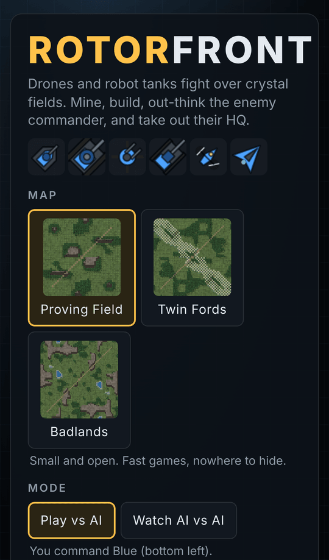
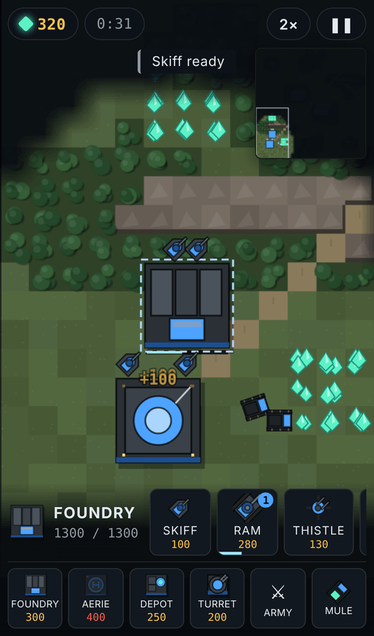
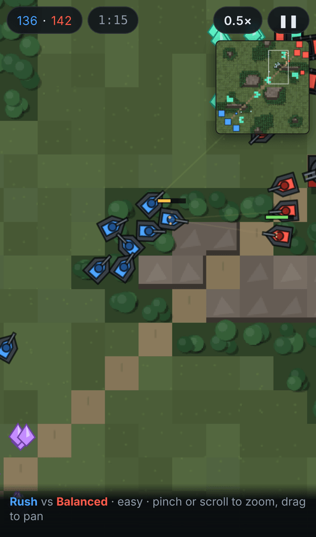
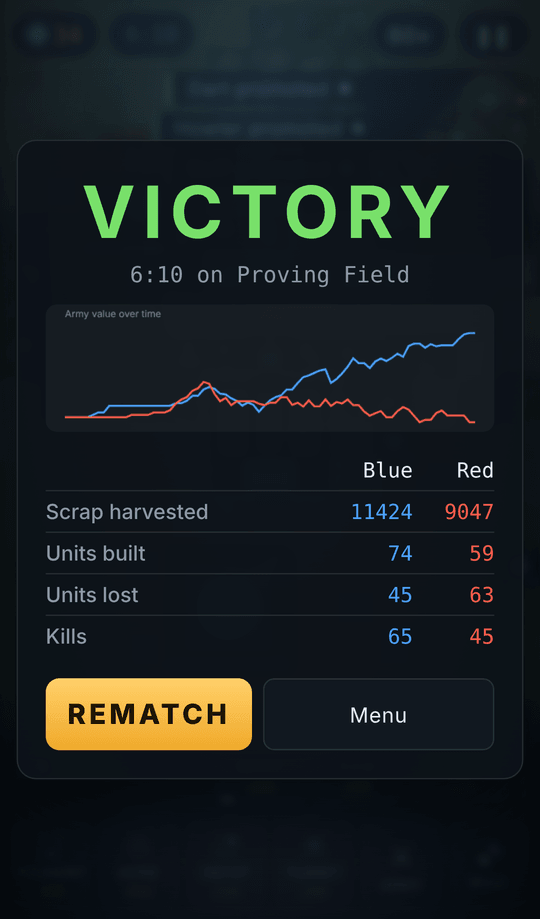
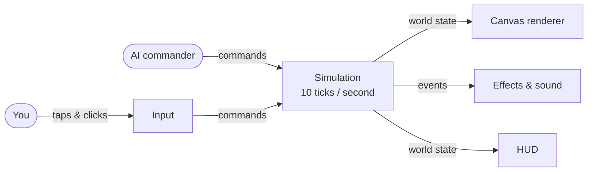

<div align="center">


# Rotorfront

**A real-time strategy game built for your phone.**<br>
Drones and robot tanks fight over crystal fields. Mine, build, out-think the enemy commander, and take out their HQ.

[](https://valentinakiyungi.github.io/rotorfront/)

[](https://github.com/valentinakiyungi/rotorfront/actions/workflows/pages.yml)


[](LICENSE)

<br>

&nbsp;
&nbsp;
&nbsp;


</div>

---

## Features

- **Touch-first controls.** Tap to select and order, long-press and drag to box-select, pinch to zoom. When you build, the game suggests a good spot so placing a building is one more tap.
- **A real counter web.** Seven units, each with a clear job and a clear weakness. Learn what beats what, then build to beat what you see.
- **An AI that plays fair.** Four personalities and three difficulties. It issues the same commands you can and only reacts to what its side can see.
- **Terrain that matters.** Roads are fast, woods slow tanks but give cover, rivers and rock block ground units, and drones fly over all of it.
- **Fog of war.** You only see what your units see. Enemy buildings you've spotted stay on the map as ghosts.
- **Veterans.** Units that score kills earn ★ ranks and hit harder.
- **Watch mode.** Put two AI commanders against each other at up to 4× speed.
- **After-action report.** An army-strength timeline and the stats that decided the match.
- **Lightweight.** Zero runtime dependencies, every sound synthesised live, installable to your home screen.

## Units

| | Unit | Role | Beats | Loses to |
|:-:|---|---|---|---|
|  | **Mule** | Harvester. Mines crystal and hauls it home. | — | Everything |
|  | **Skiff** | Fast light tank | Howler, Thistle | Ram, Dart |
|  | **Ram** | Heavy tank | Skiff, buildings | Dart, Howler |
|  | **Thistle** | Flak walker, shoots aircraft only | Dart, Kestrel | Any ground unit |
|  | **Howler** | Artillery with slow, dodgeable shells | Clumps, Turrets | Skiff, Dart |
|  | **Dart** | Strike drone | Ram, Howler, Mules | Thistle, Kestrel, Turret |
|  | **Kestrel** | Interceptor drone, shoots aircraft only | Dart | Any ground unit |

**Buildings:** HQ · Foundry (tanks) · Aerie (drones) · Depot (forward drop-off) · Turret (hits ground and air).

**Maps:** Proving Field (small and open) · Twin Fords (a river with three crossings) · Badlands (mesas and choke points). Every map is a perfect mirror, so neither side starts ahead.

## Controls

| Action | Touch | Mouse & keyboard |
|---|---|---|
| Select | Tap a unit | Click |
| Select a group | Long-press, then drag | Drag a box |
| Select all of a type | Double-tap a unit | Double-click a unit |
| Move / attack | Tap the ground / an enemy | Right-click |
| Attack-move | **⚔ Attack-move**, then tap | `Q`, then right-click |
| Select whole army | **Army** button | `Space` |
| Stop | **■** button | `X` |
| Pan and zoom | Drag, pinch | `WASD` / arrows, scroll wheel |
| Pause | **❚❚** button | `P` |

## Getting started

You need [Node.js 22](https://nodejs.org) or newer.

```bash
git clone https://github.com/valentinakiyungi/rotorfront.git
cd rotorfront
npm install
npm run dev
```

Open the `Local` link to play. The `Network` link works on a phone connected to the same Wi-Fi.

| Command | What it does |
|---|---|
| `npm run dev` | Start the dev server with hot reload |
| `npm test` | Run the simulation tests |
| `npm run build` | Typecheck and build into `dist/` |
| `npm run preview` | Serve the production build locally |
| `npm run match` | Run headless AI-vs-AI matches on every map, for balance testing |

## How it works

The game is split into a simulation that knows nothing about the screen, and a client that draws it and turns your input into commands.



- **`src/sim/`** is pure TypeScript with no browser code. It runs at a fixed 10 ticks per second with a seeded random number generator, so the same seed and the same commands always produce the same match. A match can be replayed from its command log alone, and the tests check this.
- **`src/game/`** holds the Canvas renderer (smoothed between ticks), the camera, gesture recognition, effects and synthesised audio.
- **`src/ui/`** holds the HUD, menus and the after-action report.
- **`tests/`** covers the simulation; **`tools/match.ts`** runs AI-vs-AI games in bulk.

All balance numbers live in [`src/sim/balance.ts`](src/sim/balance.ts). The full design and roadmap are in [DESIGN.md](DESIGN.md).

## Roadmap

- [ ] Rebalance so every AI personality has a fair chance
- [ ] Saved squads you can recall with one tap
- [ ] Shareable replays
- [ ] An arena where AI models play each other
- [ ] Online multiplayer
- [ ] Offline play

## Credits

Inspired by [Battle Drones](https://github.com/simonw/battledrones) by Simon Willison. All code, units and art in this repository are original.

## License

[MIT](LICENSE)
